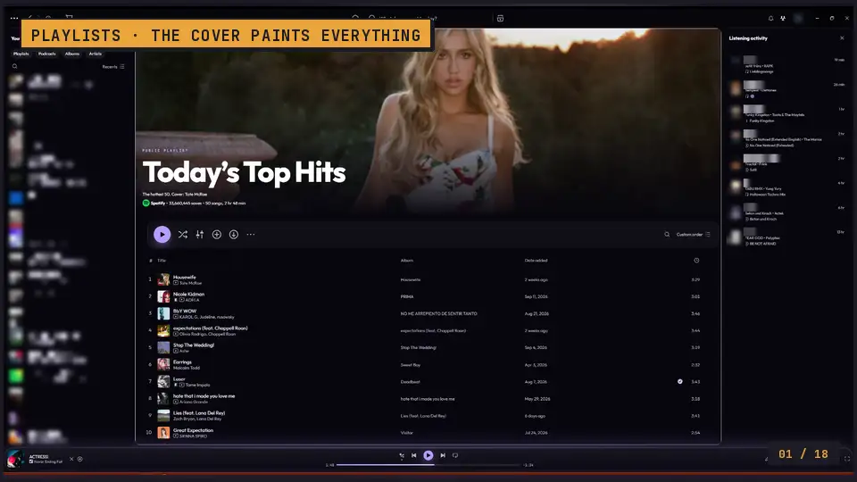

<picture><source media="(prefers-color-scheme: dark)" srcset="assets/cover-dark.svg"/></picture>

I work where <b>IT management, project leadership and sales</b> meet – steering digital projects, aligning IT security with business value and translating technology into something people buy into. On the side I build apps, automations, self-hosted services and Spotify themes with AI-assisted workflows.

<picture><source media="(prefers-color-scheme: dark)" srcset="assets/ch-1-dark.svg"/></picture>

<picture><source media="(prefers-color-scheme: dark)" srcset="assets/origin-dark.svg"/></picture>

<b>TOOLS OF THE TRADE</b>  
<picture><source media="(prefers-color-scheme: dark)" srcset="https://skillicons.dev/icons?i=docker%2Cnginx%2Clinux%2Cgit%2Creact%2Celectron%2Cjs%2Ccss%2Cpython%2Clua%2Cbash&theme=dark"/></picture>

<picture><source media="(prefers-color-scheme: dark)" srcset="assets/ch-2-dark.svg"/></picture>

<picture><source media="(prefers-color-scheme: dark)" srcset="assets/stats-dark.svg"/></picture>

<picture><source media="(prefers-color-scheme: dark)" srcset="assets/ch-3-dark.svg"/></picture>

<!--HOSTWERK:START-->
<a href="https://github.com/Passimoritz/hostwerk-public"><picture><source media="(prefers-color-scheme: dark)" srcset="assets/hostwerk-dark.svg"/></picture></a>

<a href="https://github.com/Passimoritz/hostwerk-ext-steam" title="Game library – All your games in one place: Steam without signing in (games, size, drive, playtime, downloads), plus Epic Games and GOG from this PC and.&#10;Games &amp; Minecraft · part of Hostwerk · v2.0.0"><picture><source media="(prefers-color-scheme: dark)" srcset="assets/ext/steam-dark.svg"/></picture></a>
<a href="https://github.com/Passimoritz/hostwerk-ext-game-servers" title="Game servers – Valheim, Palworld, Satisfactory, Rust, ARK and every other Steam server tool through SteamCMD.&#10;Games &amp; Minecraft · part of Hostwerk · v2.0.0"><picture><source media="(prefers-color-scheme: dark)" srcset="assets/ext/game-servers-dark.svg"/></picture></a>
<a href="https://github.com/Passimoritz/hostwerk-ext-mc-network" title="Minecraft server network – Several Minecraft servers behind one address and Java together with Bedrock.&#10;Games &amp; Minecraft · part of Hostwerk · v1.5.0"><picture><source media="(prefers-color-scheme: dark)" srcset="assets/ext/mc-network-dark.svg"/></picture></a>
<a href="https://github.com/Passimoritz/hostwerk-ext-minecraft" title="Minecraft servers – Minecraft servers with Paper, Purpur, Folia, Fabric, NeoForge, Forge, Velocity, Bedrock and modpacks.&#10;Games &amp; Minecraft · part of Hostwerk · v1.1.0"><picture><source media="(prefers-color-scheme: dark)" srcset="assets/ext/minecraft-dark.svg"/></picture></a>
<a href="https://github.com/Passimoritz/hostwerk-ext-player-ticker" title="Players – Who is on your Minecraft and game servers right now and who plays the most.&#10;Games &amp; Minecraft · part of Hostwerk · v2.0.0"><picture><source media="(prefers-color-scheme: dark)" srcset="assets/ext/player-ticker-dark.svg"/></picture></a>
<a href="https://github.com/Passimoritz/hostwerk-ext-schematics-3d" title="Schematics in 3D – Look at Minecraft builds in 3D before you place them.&#10;Games &amp; Minecraft · part of Hostwerk · v1.2.2"><picture><source media="(prefers-color-scheme: dark)" srcset="assets/ext/schematics-3d-dark.svg"/></picture></a>
<a href="https://github.com/Passimoritz/hostwerk-ext-dns" title="DNS management – Free names for your connection (DuckDNS, deSEC, dynv6, FreeDNS, No-IP) or your own domain at Cloudflare, deSEC, Hetzner, INWX or IONOS.&#10;Network &amp; machines · part of Hostwerk · v1.3.0"><picture><source media="(prefers-color-scheme: dark)" srcset="assets/ext/dns-dark.svg"/></picture></a>
<a href="https://github.com/Passimoritz/hostwerk-ext-file-share" title="File share (SFTP) – Share a folder over SFTP or as a download link.&#10;Network &amp; machines · part of Hostwerk · v1.3.3"><picture><source media="(prefers-color-scheme: dark)" srcset="assets/ext/file-share-dark.svg"/></picture></a>
<a href="https://github.com/Passimoritz/hostwerk-ext-hostwerk-network" title="Hostwerk network – Several machines as one network.&#10;Network &amp; machines · part of Hostwerk · v1.2.4"><picture><source media="(prefers-color-scheme: dark)" srcset="assets/ext/hostwerk-network-dark.svg"/></picture></a>
<a href="https://github.com/Passimoritz/hostwerk-ext-router" title="Router &amp; port forwarding – Makes your servers reachable from the internet.&#10;Network &amp; machines · part of Hostwerk · v1.5.0"><picture><source media="(prefers-color-scheme: dark)" srcset="assets/ext/router-dark.svg"/></picture></a>
<a href="https://github.com/Passimoritz/hostwerk-ext-vpn" title="VPN access – WireGuard access for your devices and friends.&#10;Network &amp; machines · part of Hostwerk · v1.2.2"><picture><source media="(prefers-color-scheme: dark)" srcset="assets/ext/vpn-dark.svg"/></picture></a>
<a href="https://github.com/Passimoritz/hostwerk-ext-cert-watch" title="Certificate watch – All certificates at a glance: Hostwerk’s own and any host (mail server, router, other sites).&#10;Security &amp; access · part of Hostwerk · v2.2.0"><picture><source media="(prefers-color-scheme: dark)" srcset="assets/ext/cert-watch-dark.svg"/></picture></a>
<a href="https://github.com/Passimoritz/hostwerk-ext-pwa" title="Hostwerk app – Hostwerk on your phone – as a web app for Android and iPhone, without an app store.&#10;Security &amp; access · part of Hostwerk · v1.1.0"><picture><source media="(prefers-color-scheme: dark)" srcset="assets/ext/pwa-dark.svg"/></picture></a>
<a href="https://github.com/Passimoritz/hostwerk-ext-passwords" title="Password manager – Own encrypted vault (Argon2id) or Bitwarden/Vaultwarden, 1Password, KeePass, pass and LastPass.&#10;Security &amp; access · part of Hostwerk · v2.3.1"><picture><source media="(prefers-color-scheme: dark)" srcset="assets/ext/passwords-dark.svg"/></picture></a>
<a href="https://github.com/Passimoritz/hostwerk-ext-team" title="Team &amp; roles – Friends and colleagues with their own sign-in for remote access.&#10;Security &amp; access · part of Hostwerk · v1.3.2"><picture><source media="(prefers-color-scheme: dark)" srcset="assets/ext/team-dark.svg"/></picture></a>
<a href="https://github.com/Passimoritz/hostwerk-ext-vuln-watch" title="Vulnerability watch – Every known vulnerability (CVE, CVSS) of your services at a glance.&#10;Security &amp; access · part of Hostwerk · v1.3.2"><picture><source media="(prefers-color-scheme: dark)" srcset="assets/ext/vuln-watch-dark.svg"/></picture></a>
<a href="https://github.com/Passimoritz/hostwerk-ext-backup-calendar" title="Backup calendar &amp; cloud – How well is your data backed up? A traffic light per area, last and next backup, open failures with “Run again”.&#10;Monitoring &amp; status · part of Hostwerk · v3.0.0"><picture><source media="(prefers-color-scheme: dark)" srcset="assets/ext/backup-calendar-dark.svg"/></picture></a>
<a href="https://github.com/Passimoritz/hostwerk-ext-disk-health" title="Drives – How healthy and how full your drives are.&#10;Monitoring &amp; status · part of Hostwerk · v2.4.0"><picture><source media="(prefers-color-scheme: dark)" srcset="assets/ext/disk-health-dark.svg"/></picture></a>
<a href="https://github.com/Passimoritz/hostwerk-ext-server-card" title="Server profile – Everything important about this PC and its services as a tab under System.&#10;Monitoring &amp; status · v1.4.1"><picture><source media="(prefers-color-scheme: dark)" srcset="assets/ext/server-card-dark.svg"/></picture></a>
<a href="https://github.com/Passimoritz/hostwerk-ext-status-wall" title="Status Wall – All services big and colourful at a glance.&#10;Monitoring &amp; status · part of Hostwerk · v2.0.0"><picture><source media="(prefers-color-scheme: dark)" srcset="assets/ext/status-wall-dark.svg"/></picture></a>
<a href="https://github.com/Passimoritz/hostwerk-ext-visitor-stats" title="Visitor stats – How many visitors do your sites get? Reads the access logs of your Hostwerk web servers (Apache, nginx, Caddy).&#10;Monitoring &amp; status · part of Hostwerk · v1.2.2"><picture><source media="(prefers-color-scheme: dark)" srcset="assets/ext/visitor-stats-dark.svg"/></picture></a>
<a href="https://github.com/Passimoritz/hostwerk-ext-api-tester" title="API tester – Build, send and save requests to your projects.&#10;Developer tools · part of Hostwerk · v1.5.2"><picture><source media="(prefers-color-scheme: dark)" srcset="assets/ext/api-tester-dark.svg"/></picture></a>
<a href="https://github.com/Passimoritz/hostwerk-ext-page-check" title="Page check – Checks pages of your web projects.&#10;Developer tools · part of Hostwerk · v1.1.2"><picture><source media="(prefers-color-scheme: dark)" srcset="assets/ext/page-check-dark.svg"/></picture></a>
<a href="https://github.com/Passimoritz/hostwerk-ext-profiler" title="Profiler – Finds out why a page or app is slow.&#10;Developer tools · part of Hostwerk · v1.1.3"><picture><source media="(prefers-color-scheme: dark)" srcset="assets/ext/profiler-dark.svg"/></picture></a>
<a href="https://github.com/Passimoritz/hostwerk-ext-static-publish" title="Publish static sites – Publish projects with one click.&#10;Developer tools · part of Hostwerk · v2.0.0"><picture><source media="(prefers-color-scheme: dark)" srcset="assets/ext/static-publish-dark.svg"/></picture></a>
<a href="https://github.com/Passimoritz/hostwerk-ext-vms" title="Virtual machines – Virtual machines like VirtualBox.&#10;Developer tools · part of Hostwerk · v1.0.6"><picture><source media="(prefers-color-scheme: dark)" srcset="assets/ext/vms-dark.svg"/></picture></a>
<a href="https://github.com/Passimoritz/hostwerk-ext-webhook-inbox" title="Webhook inbox – An address for the webhooks of Stripe, GitHub, Shopify, Slack &amp; co. – public through Hostwerk&#x27;s tunnel if you like.&#10;Developer tools · part of Hostwerk · v1.4.1"><picture><source media="(prefers-color-scheme: dark)" srcset="assets/ext/webhook-inbox-dark.svg"/></picture></a>
<a href="https://github.com/Passimoritz/hostwerk-ext-claude" title="AI Connect – Connect any AI with Hostwerk – Cursor, VS Code, Windsurf, LM Studio, Claude, Codex, Gemini CLI and any other MCP app.&#10;AI &amp; media · part of Hostwerk · v1.5.1"><picture><source media="(prefers-color-scheme: dark)" srcset="assets/ext/claude-dark.svg"/></picture></a>
<a href="https://github.com/Passimoritz/hostwerk-ext-ai-media" title="Image &amp; video studio – Create pictures and short videos from a description.&#10;AI &amp; media · part of Hostwerk · v1.3.1"><picture><source media="(prefers-color-scheme: dark)" srcset="assets/ext/ai-media-dark.svg"/></picture></a>
<a href="https://github.com/Passimoritz/hostwerk-ext-knowledge-graph" title="Knowledge graph – Turns your projects (code, docs, Obsidian notes) into a searchable knowledge graph.&#10;AI &amp; media · v1.5.3"><picture><source media="(prefers-color-scheme: dark)" srcset="assets/ext/knowledge-graph-dark.svg"/></picture></a>
<a href="https://github.com/Passimoritz/hostwerk-ext-discord-bot" title="Discord control – Your own Discord bot for Hostwerk.&#10;Mail &amp; communication · part of Hostwerk · v1.3.1"><picture><source media="(prefers-color-scheme: dark)" srcset="assets/ext/discord-bot-dark.svg"/></picture></a>
<a href="https://github.com/Passimoritz/hostwerk-ext-discord-status" title="Discord status – Shows “Playing Hostwerk” in your Discord profile.&#10;Mail &amp; communication · part of Hostwerk · v1.3.0"><picture><source media="(prefers-color-scheme: dark)" srcset="assets/ext/discord-status-dark.svg"/></picture></a>
<a href="https://github.com/Passimoritz/hostwerk-ext-mail-accounts" title="E-mail accounts – Your mailboxes from Gmail, Outlook, web.de, GMX, T-Online, iCloud, Yahoo, Posteo, mailbox.org or your own domain right inside Hostwerk.&#10;Mail &amp; communication · part of Hostwerk · v1.1.0"><picture><source media="(prefers-color-scheme: dark)" srcset="assets/ext/mail-accounts-dark.svg"/></picture></a>
<a href="https://github.com/Passimoritz/hostwerk-ext-mail-server" title="Mail server – Real mailboxes with your own domain.&#10;Mail &amp; communication · part of Hostwerk · v1.3.2"><picture><source media="(prefers-color-scheme: dark)" srcset="assets/ext/mail-server-dark.svg"/></picture></a>
<a href="https://github.com/Passimoritz/hostwerk-ext-mail-stats" title="Mail statistics – How many e-mails your projects send.&#10;Mail &amp; communication · v1.4.0"><picture><source media="(prefers-color-scheme: dark)" srcset="assets/ext/mail-stats-dark.svg"/></picture></a>
<a href="https://github.com/Passimoritz/hostwerk-ext-office" title="Office – Create, edit and read documents, spreadsheets, presentations and PDFs right in Hostwerk&#x27;s Files.&#10;Other · part of Hostwerk · v1.3.2"><picture><source media="(prefers-color-scheme: dark)" srcset="assets/ext/office-dark.svg"/></picture></a>
<a href="https://github.com/Passimoritz/hostwerk-ext-theme-pack" title="Themes – Three carefully tuned themes for Hostwerk.&#10;Other · v1.0.1"><picture><source media="(prefers-color-scheme: dark)" srcset="assets/ext/theme-pack-dark.svg"/></picture></a>
<a href="https://github.com/Passimoritz/hostwerk-ext-modes" title="One click – Services and tasks with one click.&#10;Extension · part of Hostwerk · v2.0.0"><picture><source media="(prefers-color-scheme: dark)" srcset="assets/ext/modes-dark.svg"/></picture></a>
<a href="https://github.com/Passimoritz/hostwerk-ext-service-notes" title="Service notes – Notes and checklists for every service.&#10;Extension · v1.3.2"><picture><source media="(prefers-color-scheme: dark)" srcset="assets/ext/service-notes-dark.svg"/></picture></a>

<a href="https://github.com/Passimoritz/hostwerk-public/releases/download/v3.3.0/Hostwerk-Setup-3.3.0.exe"><picture><source media="(prefers-color-scheme: dark)" srcset="assets/dl-windows-dark.svg"/></picture></a>&nbsp;&nbsp;<a href="https://github.com/Passimoritz/hostwerk-public/releases/latest"><picture><source media="(prefers-color-scheme: dark)" srcset="assets/dl-latest-dark.svg"/></picture></a>
 v3.3.0 · November 20, 2026 · 5,578 downloads · <a href="https://github.com/Passimoritz/hostwerk-public/releases/tag/v3.3.0">Release notes &amp; all files</a> · <a href="https://github.com/Passimoritz/hostwerk-public/releases">All releases</a>

<!--HOSTWERK:END-->

<picture><source media="(prefers-color-scheme: dark)" srcset="assets/ch-4-dark.svg"/></picture>

<!--MIRAGE:START-->
<a href="https://github.com/Passimoritz/spicetify-mirage"><picture><source media="(prefers-color-scheme: dark)" srcset="assets/mirage-dark.svg"/></picture></a>

<a href="https://github.com/Passimoritz/spicetify-mirage#-install"><picture><source media="(prefers-color-scheme: dark)" srcset="assets/mirage-get-dark.svg"/></picture></a>&nbsp;&nbsp;<a href="https://github.com/Passimoritz/spicetify-mirage"><picture><source media="(prefers-color-scheme: dark)" srcset="assets/mirage-src-dark.svg"/></picture></a>
 v1.28.0 · November 20, 2026 · 10 ★ · Schemes: <b>Mirage</b> · <b>Obsidian</b> · <b>Sakura</b> · <b>Abyss</b> · <b>Ember</b> · <a href="https://github.com/Passimoritz/spicetify-mirage#-mirage-overlay">Mirage Overlay</a> · <a href="https://github.com/Passimoritz/spicetify-mirage/releases">All releases</a>

<!--MIRAGE:END-->

<b>🎧 Currently on my headphones</b>

 
<a href="https://open.spotify.com/user/passimoritz">
<picture><source media="(prefers-color-scheme: dark)" srcset="https://spotify-github-profile.kittinanx.com/api/view?uid=passimoritz&cover_image=true&theme=natemoo-re&show_offline=false&interchange=true&bar_color=a596ff&bar_color_cover=true&background_color=161b22"/></picture>
</a>

<picture><source media="(prefers-color-scheme: dark)" srcset="assets/ch-5-dark.svg"/></picture>

<!--ADFREE:START-->
<a href="https://github.com/Passimoritz/yt-adfree"><picture><source media="(prefers-color-scheme: dark)" srcset="assets/adfree-dark.svg"/></picture></a>

<a href="https://github.com/Passimoritz/yt-adfree"><picture><source media="(prefers-color-scheme: dark)" srcset="https://raw.githubusercontent.com/Passimoritz/yt-adfree/main/docs/compare-dark.png"/></picture></a>

<a href="https://github.com/Passimoritz/yt-adfree/releases/download/v1.2.2/yt-adfree-1.2.2-chrome.zip"><picture><source media="(prefers-color-scheme: dark)" srcset="assets/adfree-chrome-dark.svg"/></picture></a>&nbsp;&nbsp;<a href="https://github.com/Passimoritz/yt-adfree/releases/download/v1.2.2/yt-adfree-1.2.2-firefox.zip"><picture><source media="(prefers-color-scheme: dark)" srcset="assets/adfree-firefox-dark.svg"/></picture></a>
 v1.2.2 · November 18, 2026 · ★ 0 stars · 1 downloads · <a href="https://github.com/Passimoritz/yt-adfree#install">Install guide</a> · <a href="https://github.com/Passimoritz/yt-adfree/releases">All releases</a>

<!--ADFREE:END-->

<picture><source media="(prefers-color-scheme: dark)" srcset="assets/ch-6-dark.svg"/></picture>

<!--ACTIVITY:START-->
<a href="https://github.com/Passimoritz?tab=overview"><picture><source media="(prefers-color-scheme: dark)" srcset="assets/activity-dark.svg"/></picture></a>

<a href="https://github.com/Passimoritz/hostwerk-ext-office">hostwerk-ext-office</a> · <a href="https://github.com/Passimoritz/spicetify-mirage">spicetify-mirage</a> · <a href="https://github.com/Passimoritz/hostwerk-public">hostwerk-public</a> · <a href="https://github.com/Passimoritz/hostwerk-ext-disk-health">hostwerk-ext-disk-health</a>

<!--ACTIVITY:END-->

<b>🏋️ Beyond the desk</b>

 
Full-body gym sessions, custom AMD builds, AI audio prompting and competitive gaming.

 

<picture><source media="(prefers-color-scheme: dark)" srcset="assets/footer-dark.svg"/></picture>
