I work where **IT management, project leadership and sales** meet: steering digital projects, aligning IT security with business value and translating technology into something people buy into. On the side I build apps, automations and self-hosted services with AI-assisted workflows.

| | Area | What it means in practice |
| :-: | :-- | :-- |
| 🗂️ | **IT & Project Management** | Digital initiatives, IT infrastructure, security governance |
| 💼 | **Sales Management** | Turning technical solutions into clear, scalable business value |
| 🤖 | **AI-assisted building** | Mobile apps, internal tools and automations, prototyped fast |
| 🖥️ | **Self-hosting** | Docker, Nginx and Linux servers for my own projects |

## Numbers

## Projects

<!--HOSTWERK:START-->

 3,585 downloads · <a href="https://github.com/Passimoritz/hostwerk-public/releases/latest">Release notes &amp; all files</a> · <a href="https://github.com/Passimoritz/hostwerk-public/releases">All releases</a>

<!--HOSTWERK:END-->

<b>⚡ Recent activity</b>

 

<!--ACTIVITY:START-->
⬆️ Pushed to `main` in [Passimoritz/hostwerk-public](https://github.com/Passimoritz/hostwerk-public) · 1 d ago 
⬆️ Pushed to `main` in [Passimoritz/hostwerk-ext-uptime-wall](https://github.com/Passimoritz/hostwerk-ext-uptime-wall) · 2 d ago 
⬆️ Pushed to `main` in [Passimoritz/hostwerk-ext-steam](https://github.com/Passimoritz/hostwerk-ext-steam) · 2 d ago 
⬆️ Pushed to `main` in [Passimoritz/hostwerk-ext-static-publish](https://github.com/Passimoritz/hostwerk-ext-static-publish) · 2 d ago 
⬆️ Pushed to `main` in [Passimoritz/hostwerk-ext-router](https://github.com/Passimoritz/hostwerk-ext-router) · 2 d ago 
⬆️ Pushed to `main` in [Passimoritz/hostwerk-ext-quick-tasks](https://github.com/Passimoritz/hostwerk-ext-quick-tasks) · 2 d ago 
⬆️ Pushed to `main` in [Passimoritz/hostwerk-ext-player-leaderboard](https://github.com/Passimoritz/hostwerk-ext-player-leaderboard) · 2 d ago 
⬆️ Pushed to `main` in [Passimoritz/hostwerk-ext-motd-studio](https://github.com/Passimoritz/hostwerk-ext-motd-studio) · 2 d ago
<!--ACTIVITY:END-->

<b>🐍 Contribution snake</b>

 
<picture>
  <source media="(prefers-color-scheme: dark)" srcset="https://raw.githubusercontent.com/Passimoritz/Passimoritz/output/github-snake-dark.svg"/>
  <source media="(prefers-color-scheme: light)" srcset="https://raw.githubusercontent.com/Passimoritz/Passimoritz/output/github-snake.svg"/>
  
</picture>

<b>🎧 Currently listening</b>

 

<b>🏋️ Beyond the desk</b>

 
Full-body gym sessions, custom AMD builds, AI audio prompting and competitive gaming.

